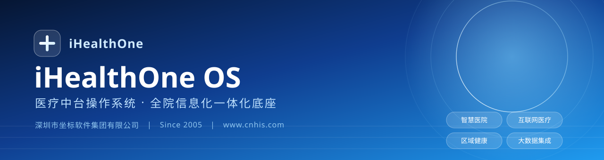
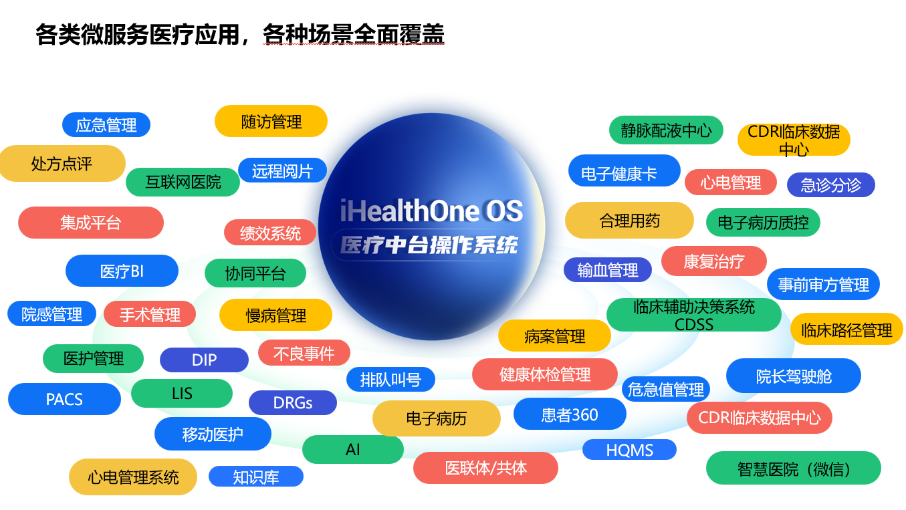
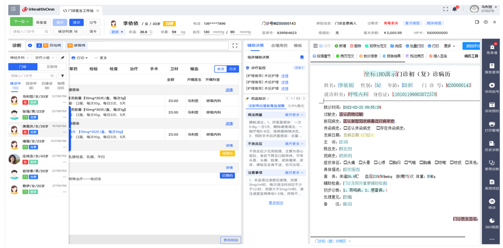
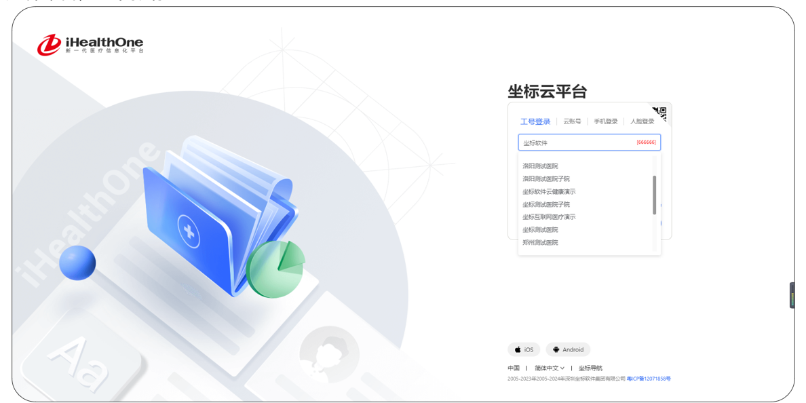
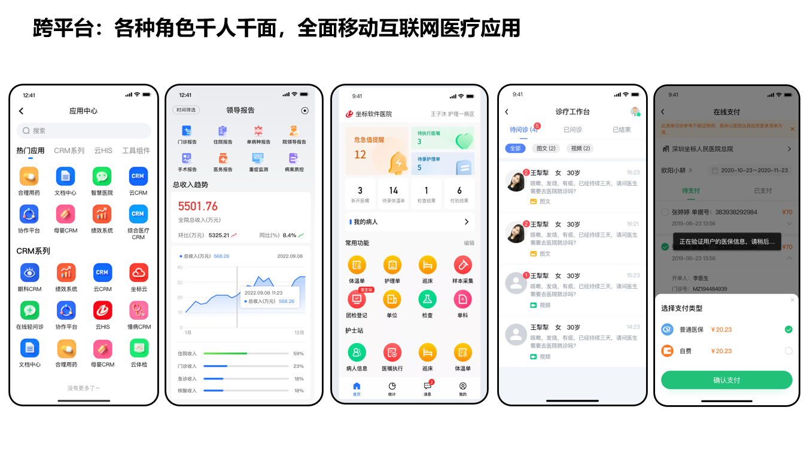
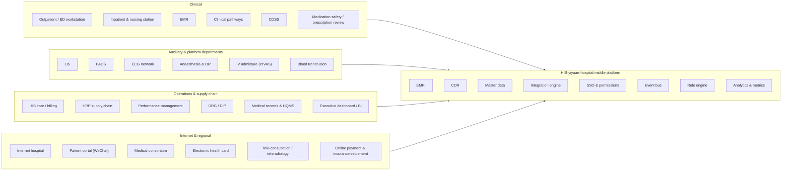
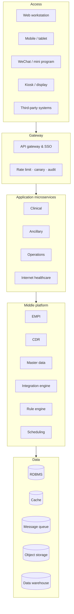

<div align="center">
  
</div>

<p align="center">
  <a href="./README.md">简体中文</a> · <b>English</b>
</p>

<h1 align="center">HIS-yiyuan-hospital · Healthcare Middle Platform</h1>

<p align="center">
  A unified information backbone for secondary / tertiary hospitals, medical groups and regional health consortia.<br/>
  One platform covering outpatient, inpatient, ancillary services, supply chain, internet healthcare and operations analytics.
</p>

<p align="center">
  <a href="https://www.cnhis.com"></a>
  
  
  
  
  
</p>

<p align="center">
  <a href="./docs/quickstart.md">Quick start</a> ·
  <a href="./docs/modules.md">Modules</a> ·
  <a href="./docs/api/README.md">Open API</a> ·
  <a href="./docs/architecture.md">Architecture</a> ·
  <a href="./docs/faq.md">FAQ</a> ·
  <a href="#-contact">Contact</a>
</p>

---

> **Shenzhen Coordinate Software Group** · founded 2005 · HQ in Shenzhen, China
> National High-Tech Enterprise · 5,000+ healthcare institutions · 300+ tertiary hospitals · 120M+ covered population
> Website: [www.cnhis.com](https://www.cnhis.com)

## What this is

**HIS-yiyuan-hospital** is a healthcare middle platform built in-house by Coordinate Software Group. It replaces the classic "one system per department, one integration rewrite per connection" model with **a shared platform plus composable microservice applications**:

- **One patient index (EMPI)** — outpatient, inpatient, check-up and internet hospital all see the same person
- **One clinical data repository (CDR)** — records, orders, labs, imaging and ECG archived and retrievable in one place
- **One master data set** — drugs, consumables, charge items, departments and staff are consistent across every system
- **One open API** — insurance, health cards, regional platforms and third-party vendors integrate by standard, not by hard-coded point-to-point links

Hospitals can roll out microservices **department by department, campus by campus** instead of a multi-month big-bang cutover.

<div align="center">
  
  <sub>Microservice applications covering the full clinical and operational landscape</sub>
</div>

## Screens

<table>
  <tr>
    <td width="50%" align="center">
      <br/>
      <sub><b>Outpatient / ED workstation</b> — patient 360, orders, CDS and prescription safety on one screen</sub>
    </td>
    <td width="50%" align="center">
      <br/>
      <sub><b>Cloud platform</b> — staff ID, cloud account or phone login; switch campuses in one click</sub>
    </td>
  </tr>
  <tr>
    <td colspan="2" align="center">
      <br/>
      <sub><b>Mobile healthcare</b> — role-based views for leadership, physicians, nursing and patient payment</sub>
    </td>
  </tr>
</table>

## Why hospitals choose it

| | Capability | Detail |
|---|---|---|
| 🧩 | **Incremental rollout** | 120+ microservices go live by campus, department or business domain; legacy systems run in parallel and are retired gradually |
| 🔗 | **Built-in integration engine** | ESB + message bus + service orchestration; HL7 v2, FHIR, DICOM and CDA supported natively — interface changes no longer touch business code |
| 🧠 | **CDS and medication safety** | Dose, interaction, allergy and insurance-limit checks fire the moment an order is placed; rules are configurable per hospital |
| 📱 | **One backend, many clients** | Web workstation, ward-round tablet, WeChat patient portal and self-service kiosks share the same services and permissions |
| 🏥 | **Multi-campus groups** | Multiple legal entities, campuses, pharmacies and price schedules; supports tight-knit county consortia and city medical groups |
| 🛡 | **On-premise first** | Fully offline-capable deployment; adapted to Xinchuang (domestic) stacks — Kylin / UOS, DM8 / KingbaseES, Kunpeng |
| ⏱ | **24/7 support** | On-site teams in major cities, 30-minute response for critical incidents |

## Capability map



## Product line

| Product | Positioning | Typical use |
|---|---|---|
| **Coordinate HIS** | Hospital core system | Registration, billing, orders, inpatient settlement, pharmacy |
| **Coordinate Cloud HIS** | Cloud / SaaS core | Fast go-live for secondary, specialty hospitals and clinic chains |
| **HIS-yiyuan-hospital** | Healthcare middle platform | System integration, data governance, group-wide backbone |
| **Coordinate EMR** | Electronic medical record | Structured records, templates, in-process QC, paperless archiving |
| **Coordinate Internet Hospital** | Online-offline integration | Consultation, refill prescriptions, drug delivery, online payment |
| **Coordinate CRM** | Patient relationship | Appointments, follow-up, chronic disease, membership |
| **Coordinate Integration Platform** | Intra/inter-hospital integration | ESB, interface monitoring, interoperability assessment support |
| **Coordinate Cloud Platform** | Unified entry & ops | Multi-campus login, cloud accounts, monitoring, release management |

## Architecture



**Stack** (demo environment; production depends on the delivery plan)

| Layer | Choice |
|---|---|
| Frontend | Vue 3 / TypeScript / Vite, qiankun micro-frontends |
| Mobile | Hybrid container + native bridge, WeChat mini program |
| Backend | Java 17 / Spring Boot / Spring Cloud Alibaba |
| Data | MySQL 8 / PostgreSQL, Redis, RocketMQ, MinIO |
| Imaging | DICOM 3.0, object storage with edge caching |
| Deployment | Docker / Kubernetes, Nginx / Keepalived HA |
| Xinchuang | Kylin V10, UOS, DM8, KingbaseES, Kunpeng / Phytium |

## Repository layout

```text
HIS-yiyuan-hospital/
├── assets/                     # Brand and product screenshots
├── docs/                       # Documentation
│   ├── quickstart.md           # Run the demo in 10 minutes
│   ├── architecture.md         # Architecture & deployment topology
│   ├── modules.md              # Microservice module catalogue
│   ├── deployment.md           # On-premise deployment & Xinchuang
│   ├── faq.md                  # FAQ
│   ├── roadmap.md              # Roadmap
│   └── api/README.md           # Open API reference
├── packages/
│   ├── sdk-js/                 # JavaScript / TypeScript SDK
│   └── cli/                    # his command-line tool
├── mock-server/                # Zero-dependency demo gateway
├── examples/
│   ├── patient-360/            # Patient 360 demo page
│   └── queue-call/             # Queue & calling integration sample
├── deploy/                     # Reverse proxy and deployment samples
├── docker-compose.yml
└── README.md
```

> ⚠️ **Important**: this is a **product demo and capability showcase repository**. Code under `packages/`, `mock-server/` and `examples/` is **sample / placeholder** implementation and all data is **fictitious test data**. It contains no production code, no hospital data and no patient information. For commercial licensing and the full product, please contact us via the website.

## Quick start

### Option 1 — Docker

```bash
git clone https://github.com/jianggong95-netizen/HIS-yiyuan-hospital.git
cd HIS-yiyuan-hospital
docker compose up -d
# open http://localhost:8787  → demo page + mock open API
```

### Option 2 — Node only (no dependencies)

```bash
node mock-server/index.js
# [HIS-yiyuan-hospital] mock gateway listening on http://localhost:8787
curl http://localhost:8787/api/v1/patients/MZ00000143
```

### Option 3 — Use the SDK

```bash
npm i @his-yiyuan-hospital/sdk
```

```ts
import { HisYiyuanHospitalClient } from '@his-yiyuan-hospital/sdk';

const client = new HisYiyuanHospitalClient({
  baseUrl: 'https://open.example-hospital.cn',
  appId: 'demo-app',
  appSecret: process.env.HIS_SECRET!,
});

// Patient 360: demographics, encounters, allergies, labs, medication
const p = await client.patient.get360('MZ00000143');
console.log(p.name, p.gender, p.age, p.allergies);

// Medication safety + insurance-limit check before prescribing
const check = await client.cds.checkPrescription({
  patientId: p.patientId,
  items: [{ drugCode: 'D0001', dose: 1, unit: 'tablet', freq: 'TID' }],
});
if (!check.passed) console.warn(check.alerts);

// Book an appointment and issue a queue number
const appt = await client.appointment.create({
  patientId: p.patientId,
  deptCode: 'DEPT-RESP',
  doctorCode: 'DOC-0231',
  visitTime: '2026-11-03T09:30:00+08:00',
});
console.log(appt.queueNo, appt.room);
```

CLI:

```bash
npx @his-yiyuan-hospital/cli doctor          # health check for config and connectivity
npx @his-yiyuan-hospital/cli patient 360 MZ00000143
```

See [docs/quickstart.md](./docs/quickstart.md) for the full walkthrough.

## Interoperability

| Standard / interface | Support |
|---|---|
| HL7 v2.x (ADT / ORM / ORU) | ✅ Native parsing and mapping |
| FHIR R4 | ✅ Mapping layer (Patient / Encounter / Observation) |
| DICOM 3.0 (C-STORE / C-FIND / WADO) | ✅ |
| National / regional insurance settlement | ✅ Per-region adapters |
| Electronic health card / health code | ✅ |
| Hospital interoperability maturity assessment | ✅ Supporting documentation from the integration platform |
| EMR application-level grading | ✅ QC and closed-loop data support |
| Single sign-on | ✅ CAS / OAuth2 / LDAP / AD |

Full API reference: [docs/api/README.md](./docs/api/README.md).

## Delivery & service

- **Implementation** — discovery → process mapping → master data governance → phased go-live → dual running → single-track cutover
- **Training** — role-based programmes for physicians, nurses, billing, pharmacy, medical records and IT operations
- **Support** — 24/7/365, with on-site, remote and spare-parts response tiers; 30-minute response for critical incidents
- **Releases** — quarterly cadence, canary rollout, hot updates without downtime
- **Assessment** — hands-on support for EMR grading, interoperability assessment and smart-service evaluation

## Scale

| Metric | Value |
|---|---|
| Healthcare institutions served | **5,000+** |
| Tertiary hospitals | **300+** |
| Registered software copyrights | **300+** |
| Covered population | **120M+** |
| Founded | **2005**, headquartered in Shenzhen |

## Roadmap

- [x] v2.4 — Middle platform 2.0: unified EMPI + CDR
- [x] v2.5 — Multi-campus groups and DRG/DIP cost control
- [x] v2.6 — Open rule platform for CDSS (hospital-defined rules)
- [ ] v2.7 — LLM-assisted record drafting and QC (beta)
- [ ] v2.8 — Consortium integration and regional imaging centre
- [ ] v3.0 — Full Xinchuang stack and cloud-native multi-tenant SaaS

Details: [docs/roadmap.md](./docs/roadmap.md).

## Contact

| Channel | Detail |
|---|---|
| 🌐 Website | [www.cnhis.com](https://www.cnhis.com) |
| 📮 Sales | Submit an enquiry via the website, or open an [issue](https://github.com/jianggong95-netizen/HIS-yiyuan-hospital/issues/new?template=feature_request.yml) |
| 🤝 Partners | Regional system integrators and healthcare IT providers are welcome |
| 💼 Careers | Engineering, implementation and pre-sales roles are open year-round |

> Want a **POC demo, a solution briefing, or a reference-site visit**? Leave your organisation and contact in an issue and our regional team will follow up.

## Licence

**This project is open source under the [Apache License 2.0](./LICENSE).** You may use, modify, distribute and commercially exploit it, provided you **keep the copyright and licence notices** ([`LICENSE`](./LICENSE) + [`NOTICE`](./NOTICE)).

| Subject | Licence |
|---|---|
| Code (`packages/`, `mock-server/`, `examples/`, `deploy/`, CI config) | Apache License 2.0 |
| Documentation (`docs/`, READMEs) | Apache License 2.0 |
| Product names and trademarks ("坐标软件", "HIS-yiyuan-hospital", "Coordinate HIS"), logos `assets/logo.svg`, `assets/banner.svg`, `assets/social-preview.*` | **Not** covered by Apache-2.0 (see Section 6); reference is allowed, endorsement is not implied |
| Product screenshots `assets/*.png` | Copyright of the company; reuse with attribution |
| The full product (production build, implementation and support) | Commercial licence — contact us via the website |

**If you redistribute this work**: keep `LICENSE` and `NOTICE`, note your changes in modified files, and do not remove copyright headers or imply trademark endorsement.

```text
Copyright 2026 Shenzhen Coordinate Software Group Co., Ltd.
深圳市坐标软件集团有限公司 · https://www.cnhis.com
```

- All sample data is fictitious (e.g. "Li Yiyi", "MZ00000143") and unrelated to any real patient.
- This is **demo code**: it carries no implementation commitment or warranty and must not be used in production as-is.

---

<div align="center">
  <sub><b>Connecting health, sharing a smarter future</b><br/>
  Shenzhen Coordinate Software Group Co., Ltd. · <a href="https://www.cnhis.com">www.cnhis.com</a></sub>
</div>
