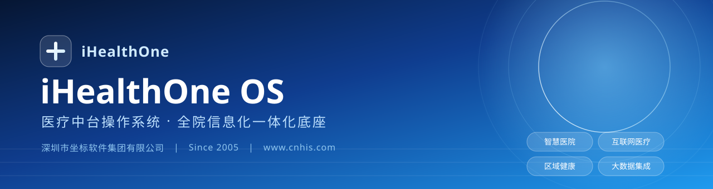
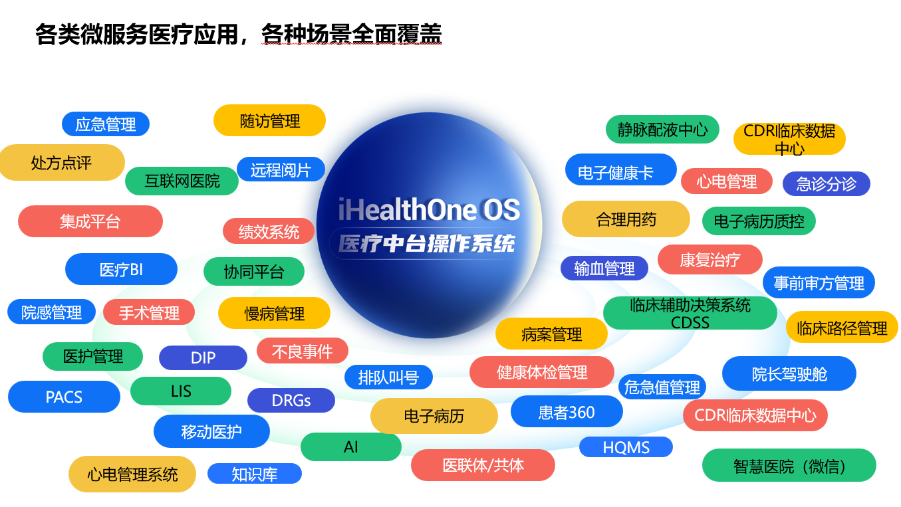
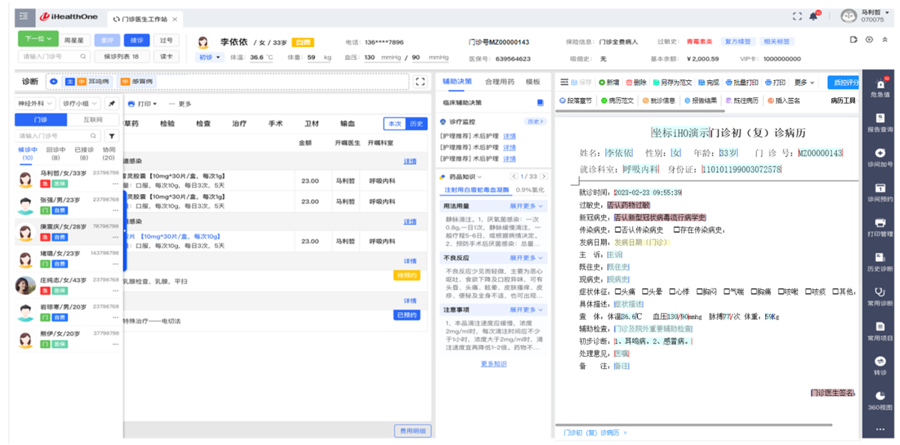
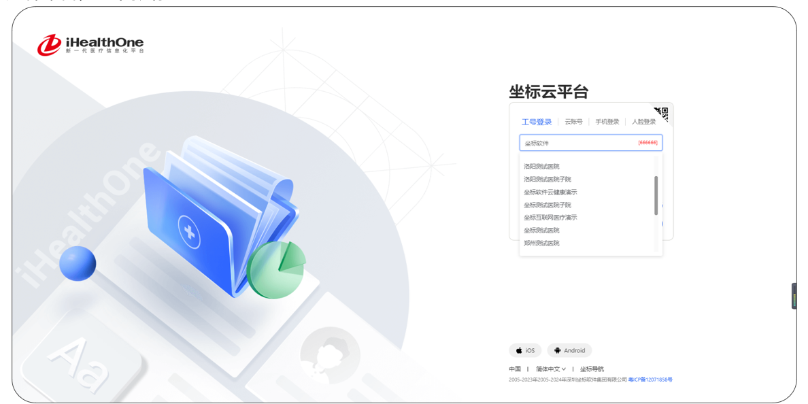
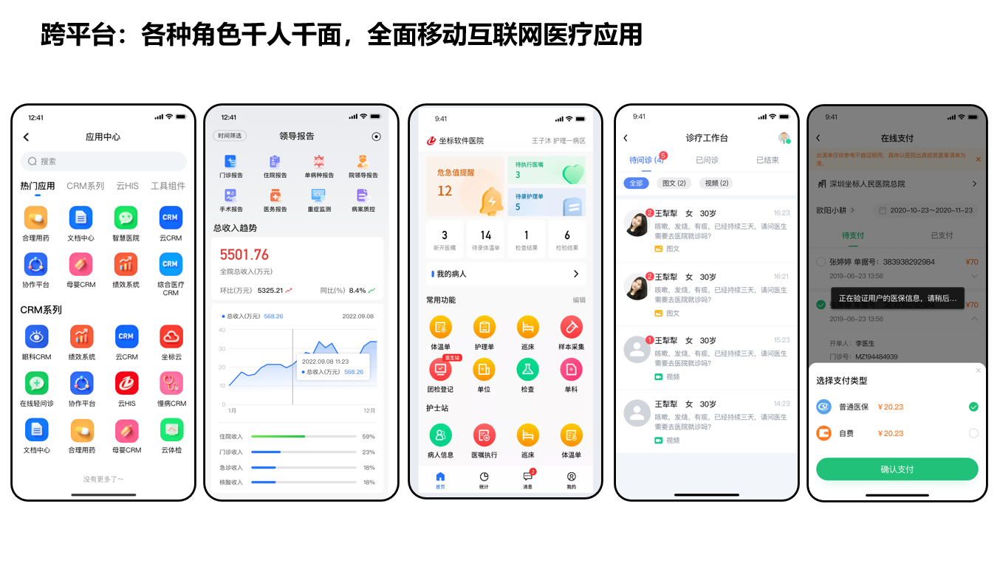
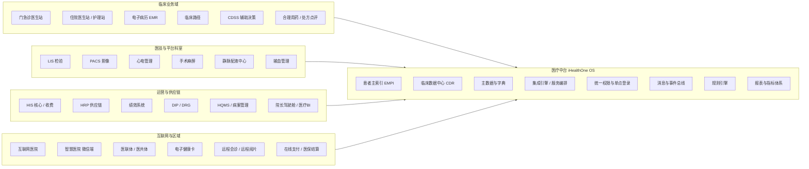
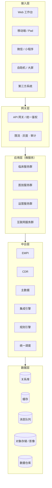

<div align="center">
  
</div>

<p align="center">
  <b>简体中文</b> · <a href="./README.en.md">English</a>
</p>

<h1 align="center">iHealthOne OS · 医疗中台操作系统</h1>

<p align="center">
  面向二级 / 三级医院、医共体与医疗集团的<strong>全院信息化一体化底座</strong><br/>
  一套中台，覆盖门急诊、住院、医技、供应链、互联网医疗与运营决策。
</p>

<p align="center">
  <a href="https://www.cnhis.com"></a>
  
  
  
  
  
</p>

<p align="center">
  <a href="./docs/quickstart.md">快速开始</a> ·
  <a href="./docs/modules.md">模块清单</a> ·
  <a href="./docs/api/README.md">开放接口</a> ·
  <a href="./docs/architecture.md">技术架构</a> ·
  <a href="./docs/faq.md">常见问题</a> ·
  <a href="#-商务合作">商务合作</a>
</p>

---

> **坐标软件集团 · 成立于 2005 年 · 总部深圳 · 国家高新技术企业 / 双软企业**
> 5000+ 医疗机构在用，300+ 三级医院用户，累计覆盖人群 1.2 亿。
> 官方网站：[www.cnhis.com](https://www.cnhis.com)

## 📌 这是什么

**iHealthOne OS** 是坐标软件集团自研的医疗中台操作系统。它把 HIS 时代"一个科室一套系统、一次对接改一遍代码"的烟囱式建设方式，重构为**统一中台 + 微服务应用**的模式：

- **一个患者主索引（EMPI）**，门急诊、住院、体检、互联网医院看到的是同一个患者；
- **一个临床数据中心（CDR）**，病历、医嘱、检验、检查、影像、心电统一归档与调阅；
- **一套主数据与字典**，药品、耗材、收费项、科室、人员全院一致，不再各系统各自维护；
- **一套开放接口**，医保、电子健康卡、区域平台、第三方厂商按标准接入，不再点对点硬编码。

医院可以按科室、按院区、按业务域**逐个上线微服务应用**，而不必"停机三个月整体切换"。

<div align="center">
  
  <sub>各类微服务医疗应用，各种场景全面覆盖</sub>
</div>

## 🖥 界面预览

<table>
  <tr>
    <td width="50%" align="center">
      <br/>
      <sub><b>门急诊医生工作站</b>：患者 360、医嘱、辅助决策、合理用药、模板病历同屏</sub>
    </td>
    <td width="50%" align="center">
      <br/>
      <sub><b>坐标云平台</b>：工号 / 云账号 / 手机登录，多院区一键切换</sub>
    </td>
  </tr>
  <tr>
    <td colspan="2" align="center">
      <br/>
      <sub><b>跨平台移动医疗</b>：各种角色千人千面 —— 领导报告、医生工作台、护理、在线支付</sub>
    </td>
  </tr>
</table>

## ✨ 为什么医院选它

| | 能力 | 说明 |
|---|---|---|
| 🧩 | **微服务可拆分上线** | 120+ 业务微服务，按院区 / 科室 / 业务域灰度上线，老系统并行运行、平滑切换 |
| 🔗 | **集成平台内建** | ESB + 消息总线 + 服务编排，HL7 v2 / FHIR / DICOM / CDA 原生支持，接口变更不动业务代码 |
| 🧠 | **CDSS 与合理用药同源** | 医嘱下达瞬间完成剂量、配伍、过敏、医保限定校验，规则库可院内自定义 |
| 📱 | **一套代码多端** | Web 工作台、Pad 查房、微信端（智慧医院）、自助机共用同一套服务与权限 |
| 🏥 | **集团化多院区** | 多法人、多院区、多药房、多套价格体系，支持紧密型医共体与城市医疗集团 |
| 🛡 | **私有化优先** | 全栈可离线私有化部署，信创环境适配（麒麟 / 统信 + 达梦 / 人大金仓 + 鲲鹏） |
| ⏱ | **7×24 全年无休** | 全国一二线城市驻点服务，重大故障 30 分钟响应 |

## 🗺 能力全景



## 🧱 产品矩阵

| 产品 | 定位 | 典型场景 |
|---|---|---|
| **坐标 HIS** | 全院核心业务系统 | 门急诊挂号收费、医嘱、住院结算、药房药库 |
| **坐标云 HIS** | 云化 / SaaS 版核心 | 二级医院、专科医院、连锁诊所快速上线 |
| **iHealthOne OS** | 医疗中台操作系统 | 多系统集成、数据治理、集团化统一底座 |
| **坐标 EMR** | 电子病历与病历质控 | 结构化病历、模板库、环节质控、无纸化归档 |
| **坐标互联网医院** | 线上线下一体化 | 图文问诊、复诊续方、药品配送、在线支付 |
| **坐标 CRM** | 患者关系与随访 | 预约随访、慢病管理、会员与健康档案 |
| **坐标集成平台** | 院内外系统集成 | ESB、接口监控、互联互通测评支撑 |
| **坐标云平台** | 统一入口与运维 | 多院区登录、云账号、运维监控、版本发布 |

## 🏗 技术架构



**技术栈**（演示环境，生产以交付方案为准）

| 层次 | 选型 |
|---|---|
| 前端 | Vue 3 / TypeScript / Vite，微前端 qiankun 拆分 |
| 移动端 | 跨平台混合容器 + 原生桥，微信小程序 |
| 服务端 | Java 17 / Spring Boot / Spring Cloud Alibaba |
| 数据 | MySQL 8 / PostgreSQL、Redis、RocketMQ、MinIO |
| 影像 | DICOM 3.0，对象存储 + 边缘缓存 |
| 部署 | Docker / Kubernetes，Nginx / Keepalived 双活 |
| 信创 | 麒麟 V10、统信 UOS、达梦 DM8、人大金仓、鲲鹏 / 飞腾 |

## 📦 仓库结构

```text
ihealthone-os/
├── assets/                     # 品牌与界面素材
├── docs/                       # 文档中心
│   ├── quickstart.md           # 10 分钟跑通演示环境
│   ├── architecture.md         # 架构与部署拓扑
│   ├── modules.md              # 微服务模块清单
│   ├── deployment.md           # 私有化部署与信创适配
│   ├── faq.md                  # 常见问题
│   ├── roadmap.md              # 产品路线图
│   └── api/README.md           # 开放接口说明
├── packages/
│   ├── sdk-js/                 # 开放平台 JavaScript / TypeScript SDK
│   └── cli/                    # 命令行工具 ih1
├── mock-server/                # 演示用 Mock 网关（零依赖）
├── examples/
│   ├── patient-360/            # 患者 360 视图示例
│   └── queue-call/             # 排队叫号对接示例
├── deploy/                     # 编排与配置
├── docker-compose.yml
└── README.md
```

> ⚠️ **重要说明**：本仓库为**产品演示与能力展示仓库**，`packages/`、`mock-server/`、`examples/` 下的代码为**示例 / 占位实现**，数据全部为**虚构测试数据**，不包含生产环境代码、院内真实数据或任何患者信息。代码以 [Apache-2.0](./LICENSE) 开源；生产版本、实施与运维服务需商业授权，请通过官网联系。

## 🚀 快速开始

### 方式一：Docker 一键启动演示环境

```bash
git clone https://github.com/jianggong95-netizen/ihealthone-os.git
cd ihealthone-os
docker compose up -d
# 打开 http://localhost:8787        → 患者 360 示例页 + Mock 开放接口
```

### 方式二：只用 Node（零依赖）

```bash
node mock-server/index.js
# [iHealthOne] mock gateway listening on http://localhost:8787
curl http://localhost:8787/api/v1/patients/MZ00000143
```

### 方式三：装 SDK，在自己的系统里调

```bash
npm i @ihealthone/sdk
```

```ts
import { IHealthOneClient } from '@ihealthone/sdk';

const client = new IHealthOneClient({
  baseUrl: 'https://open.example-hospital.cn',
  appId: 'demo-app',
  appSecret: process.env.IH1_SECRET!,
});

// 患者 360：一次拿到基本信息、就诊、过敏、检验检查、用药
const p = await client.patient.get360('MZ00000143');
console.log(p.name, p.gender, p.age, p.allergies);

// 门诊开单前的合理用药 + 医保限定校验
const check = await client.cds.checkPrescription({
  patientId: p.patientId,
  items: [{ drugCode: 'D0001', dose: 1, unit: '片', freq: 'TID' }],
});
if (!check.passed) console.warn(check.alerts);

// 创建预约并取号
const appt = await client.appointment.create({
  patientId: p.patientId,
  deptCode: 'DEPT-RESP',
  doctorCode: 'DOC-0231',
  visitTime: '2026-11-03T09:30:00+08:00',
});
console.log(appt.queueNo, appt.room);
```

### 命令行工具

```bash
npx @ihealthone/cli doctor          # 体检：检查配置与网络连通性
npx @ihealthone/cli patient 360 MZ00000143
```

完整步骤见 [docs/quickstart.md](./docs/quickstart.md)。

## 🔌 对接标准

| 标准 / 接口 | 支持情况 |
|---|---|
| HL7 v2.x（ADT / ORM / ORU） | ✅ 原生解析与映射 |
| FHIR R4 | ✅ 资源映射层（Patient / Encounter / Observation） |
| DICOM 3.0（C-STORE / C-FIND / WADO） | ✅ |
| 医保结算（国家医保 / 地方医保） | ✅ 按地区适配包 |
| 电子健康卡 / 电子健康码 | ✅ |
| 互联互通标准化成熟度测评 | ✅ 集成平台提供测评支撑文档 |
| 电子病历系统应用水平分级评价 | ✅ 病历质控与闭环数据支撑 |
| 单点登录 | ✅ CAS / OAuth2 / LDAP / AD |

接口清单与鉴权方式见 [docs/api/README.md](./docs/api/README.md)。

## 🛠 交付与服务

- **实施**：需求调研 → 流程梳理 → 主数据治理 → 分批上线 → 双轨运行 → 单轨切换
- **培训**：分角色（医生 / 护士 / 收费 / 药房 / 病案 / 运维）分层培训与考核
- **服务**：7×24 全年无休，驻点 + 远程 + 备件三级响应；重大故障 30 分钟响应
- **升级**：季度版本迭代，灰度发布，支持不停机热更新
- **测评**：电子病历分级评价、互联互通测评、智慧服务分级评估全程陪跑

## 📈 客户与规模

| 指标 | 数值 |
|---|---|
| 医疗机构服务数量 | **5000+** |
| 三级医院用户 | **300+** |
| 独立医疗软件著作权 | **300+** |
| 累计覆盖人群 | **1.2 亿** |
| 成立时间 | **2005 年**（总部深圳） |

## 🗓 路线图

- [x] v2.4 医疗中台 2.0，EMPI + CDR 统一
- [x] v2.5 多院区集团化与 DIP/DRG 精细化
- [x] v2.6 CDSS 规则开放平台（院内可自定义规则）
- [ ] v2.7 大模型辅助病历生成与质控（内测）
- [ ] v2.8 医共体一体化 + 区域影像中心
- [ ] v3.0 全信创栈 + 云原生多租户 SaaS

详见 [docs/roadmap.md](./docs/roadmap.md)。

## 🤝 商务合作

| 渠道 | 信息 |
|---|---|
| 🌐 官方网站 | [www.cnhis.com](https://www.cnhis.com) |
| 📮 商务咨询 | 请通过官网"联系我们"提交需求，或在本仓库提 [Issue](https://github.com/jianggong95-netizen/ihealthone-os/issues/new?template=feature_request.yml) |
| 🤝 渠道 / 代理 | 欢迎区域集成商、医疗信息化服务商洽谈合作 |
| 💼 人才招聘 | 研发、实施、售前岗位长期开放，简历请走官网投递 |

> 需要在贵院做 **POC 演示 / 方案汇报 / 参观样板医院**，可在 Issue 中留下单位与联系方式，我们会安排属地团队对接。

## ⚖️ 许可与版权

**本项目以 [Apache License 2.0](./LICENSE) 开源**：可自由使用、修改、分发，包括商业使用，条件是**保留版权与许可声明**（[LICENSE](./LICENSE) + [NOTICE](./NOTICE)）。

| 对象 | 许可 |
|---|---|
| 代码（`packages/`、`mock-server/`、`examples/`、`deploy/`、CI 配置） | Apache License 2.0 |
| 文档（`docs/`、README） | Apache License 2.0 |
| 产品名称与商标（"坐标软件" / "iHealthOne" / "坐标 HIS"）、徽标 `assets/logo.svg`、`assets/banner.svg`、`assets/social-preview.*` | **不在** Apache-2.0 授权范围（见 LICENSE 第 6 条），可指明出处引用，不得暗示官方背书 |
| 产品界面截图 `assets/*.png` | 版权归本公司所有，引用请注明出处与官网 |
| 完整产品（生产版本、实施与运维服务） | 商业授权，请联系官网 |

**再分发时请做到这三点**：

1. 随分发物保留 [`LICENSE`](./LICENSE) 与 [`NOTICE`](./NOTICE)；
2. 修改过的文件加注变更说明；
3. 不删除源码中的版权声明，不使用本公司商标暗示背书。

```text
Copyright 2026 深圳市坐标软件集团有限公司
Shenzhen Coordinate Software Group Co., Ltd. · https://www.cnhis.com
```

- 示例数据均为虚构（如"李依依""MZ00000143"），与任何真实患者无关，不含任何院内真实数据。
- 本仓库为**演示代码**，不构成实施承诺或质量保证，请勿直接用于生产环境；医疗场景下的合规责任由实施方与使用方共同承担。

---

<div align="center">
  <sub><b>连接你我健康，畅享智慧未来</b><br/>
  深圳市坐标软件集团有限公司 · 粤ICP备12011856号 · <a href="https://www.cnhis.com">www.cnhis.com</a></sub>
</div>
