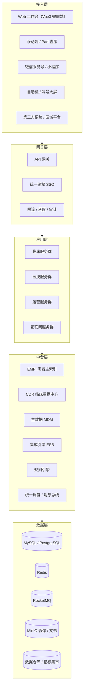
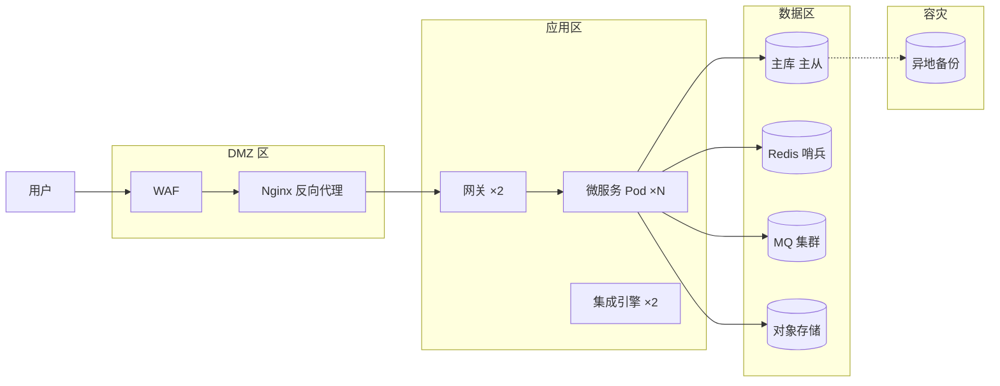

# 技术架构

## 总体思路

传统 HIS 的结构性问题是"业务逻辑写死在单体里，接口散落成点对点的蜘蛛网"。HIS-yiyuan-hospital 的做法是把**共性能力下沉到中台**，把**业务差异留在微服务**：

- 患者是谁 → EMPI 管
- 数据长什么样 → 主数据 + CDR 管
- 系统之间怎么说话 → 集成引擎管
- 谁能看什么 → 统一权限管
- 业务怎么走 → 各业务微服务管

结果是：新增一个院区、接一家医共体成员单位、上一个第三方专科系统，改动集中在中台，而不是散落到 20 个系统里。

## 逻辑分层



## 关键设计

### 1. EMPI：一人一档

| 能力 | 做法 |
|---|---|
| 主索引生成 | 院内患者 ID + 卡号（就诊卡 / 医保卡 / 电子健康卡）多源归一 |
| 重复合并 | 姓名 + 性别 + 出生日期 + 证件号 + 手机号加权匹配，分值超阈值进入人工确认队列 |
| 患者 360 | 以 EMPI 为主键聚合各业务库，读模型异步构建，不侵入业务库 |

### 2. CDR：临床数据统一归档

- 业务系统写入时通过消息总线发出领域事件，CDR 消费后落宽表；
- 文档类（病历、报告、知情同意书）落对象存储，CDR 只存索引；
- 对外提供"按患者 / 按就诊 / 按时间窗"三种检索维度。

### 3. 集成引擎：接口是配置，不是代码

```text
第三方系统 → HL7 v2 ADT^A01 → 集成引擎 → 字段映射 → 服务编排 → 目标微服务
```

- 支持 HL7 v2.x、FHIR R4、DICOM、WebService、REST、数据库视图、文件投递；
- 报文映射用可视化配置，改字段不需要发版；
- 全链路留痕：每条消息可回放、可重推、可对账。

### 4. 规则引擎：临床规则可院内自定义

合理用药、CDSS 提示、危急值阈值、医保限定，统一走规则引擎：

| 规则类型 | 示例 |
|---|---|
| 过敏禁忌 | 患者青霉素过敏 → 禁用 β-内酰胺类 |
| 剂量校验 | 单次剂量 > 上限 → 拦截并提示 |
| 配伍禁忌 | 两组输液同瓶 → 提示 |
| 医保限定 | 限适应症 / 限二级以上医院 |
| 路径偏离 | 入径患者未按节点执行 → 提醒 |

### 5. 多院区与集团化

| 维度 | 策略 |
|---|---|
| 数据隔离 | 按 `tenant_id` + `org_id` 双层隔离，支持独立库 / 共享库两种模式 |
| 字典 | 集团级标准字典 + 院区级扩展项，向下继承 |
| 价格 | 院区独立价格体系，支持医保目录差异化 |
| 权限 | 人员可跨院区授权，操作日志按院区归集 |

## 部署拓扑（生产参考）



| 指标 | 目标 |
|---|---|
| 门诊高峰并发 | ≥ 1500 会话 |
| 核心接口 P99 | ≤ 300 ms |
| 可用性 | ≥ 99.95%（双活 + 故障转移） |
| RPO / RTO | RPO ≤ 5 min / RTO ≤ 30 min |

## 演示仓库与生产版本的差异

| 项 | 演示仓库 | 生产版本 |
|---|---|---|
| 代码 | 示例 / 占位实现 | 完整业务实现 |
| 鉴权 | 无校验 | AK/SK 签名 + IP 白名单 |
| 数据库 | JSON 文件 | MySQL / PostgreSQL 集群 |
| 部署 | 单进程 Node | K8s / 双活集群 |
| 数据 | 虚构 3 条患者 | 院内真实数据（不出院） |

> 生产代码与实施文档不通过 GitHub 分发，请通过 [www.cnhis.com](https://www.cnhis.com) 联系商务获取授权与交付。
